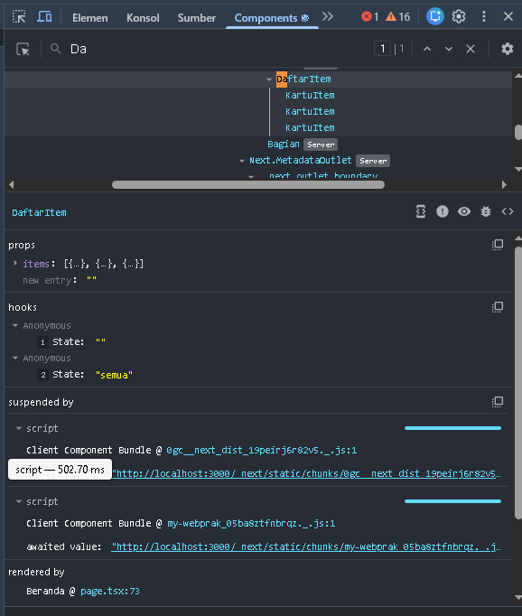
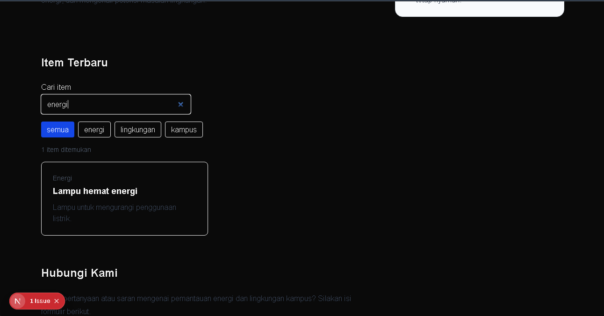
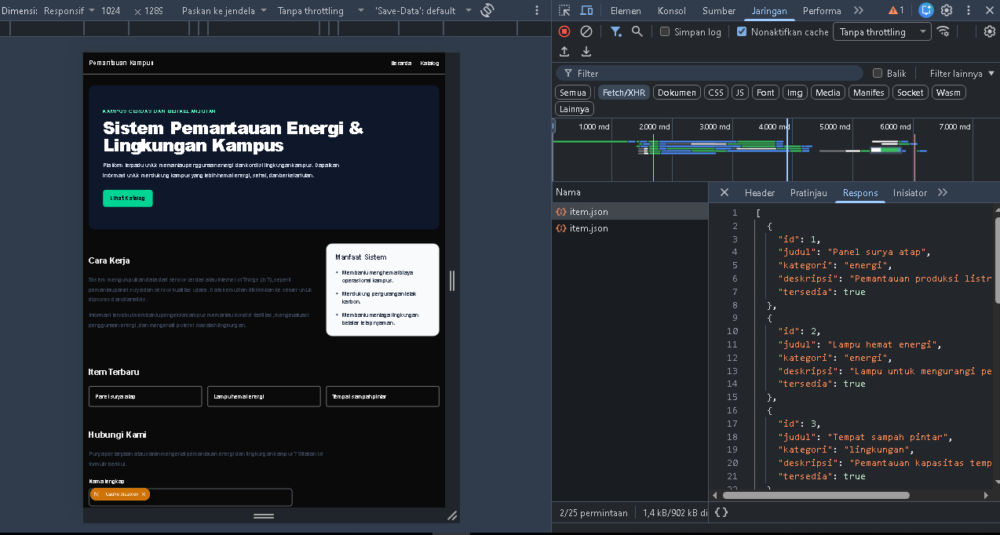

# Dokumen Teknis Modul 3 — TypeScript dan Komponen React

**Nama/NIM:** Rizqy hergiansyah / 105224010 

**Repositori:** https://github.com/hergiansyah24/praktikum-pemweb-/tree/main/week-3

## 1. Tipe Data Produk

Tipe data aplikasi didefinisikan pada file `lib/tipe.ts`. Aplikasi menggunakan union type `Kategori` dan interface `Item` untuk menjaga konsistensi struktur data.

```typescript
export type Kategori =
  | "energi"
  | "lingkungan"
  | "kampus";

export interface Item {
  id: number;
  judul: string;
  kategori: Kategori;
  deskripsi: string;
  tersedia: boolean;
  gambar?: string;
}
```

Union type `Kategori` membatasi nilai kategori menjadi `"energi"`, `"lingkungan"`, atau `"kampus"`. Dengan demikian, kesalahan penulisan kategori dapat dideteksi oleh TypeScript.

Interface `Item` menentukan struktur data setiap item. Properti `id`, `judul`, `kategori`, `deskripsi`, dan `tersedia` wajib diisi. Properti `gambar` bersifat opsional karena tidak semua item harus memiliki gambar. Tanda `?` digunakan untuk menunjukkan bahwa properti tersebut boleh tidak tersedia.

Pada `components/KartuItem.tsx`, `Record<Kategori, string>` digunakan untuk memetakan kategori ke label yang ditampilkan. Penggunaan tipe tersebut membantu memastikan setiap kategori mempunyai label bertipe string.

## 2. Struktur Komponen

### 2.1 Diagram Pohon Komponen

Berdasarkan struktur kode yang diperiksa, pohon komponen utama halaman beranda adalah sebagai berikut.

```text
app/page.tsx (Server Component)
├── Bagian — Cara Kerja
├── Bagian — Item Terbaru
│   └── DaftarItem (Client Component)
│       └── KartuItem
└── Bagian — Hubungi Kami
```

`app/page.tsx` merupakan Server Component secara default karena tidak menggunakan direktif `"use client"`. Komponen `DaftarItem` merupakan Client Component karena menggunakan `useState` dan event handler untuk menangani pencarian serta filter kategori.

Pohon tersebut menggambarkan bagian utama halaman beranda, bukan keseluruhan komponen pada semua halaman.

### 2.2 Tabel Komponen

| Nama komponen/file | Props atau data | Tempat digunakan dan fungsi |
|---|---|---|
| `app/page.tsx` | Mengimpor `daftarItem` | Halaman beranda dan penyusun bagian halaman. |
| `app/katalog/page.tsx` | Mengimpor `daftarItem` | Halaman pada rute `/katalog`. |
| `components/Bagian.tsx` | `id`, `judul`, `children` | Membungkus konten setiap bagian halaman. |
| `components/DaftarItem.tsx` | `items: Item[]` | Menampilkan daftar item serta mengelola pencarian dan filter. |
| `components/KartuItem.tsx` | `item: Item` | Menampilkan kategori, judul, deskripsi, dan status ketersediaan satu item. |
| `components/SiteHeader.tsx` | Sesuai definisi props komponen | Menampilkan header dan navigasi. |
| `components/SiteFooter.tsx` | Nama produk | Menampilkan informasi footer. |
| `lib/tipe.ts` | `Kategori` dan `Item` | Mendefinisikan tipe data yang digunakan aplikasi. |
| `lib/data.ts` | Array `daftarItem` | Menyediakan data item statis. |

Pemisahan komponen dilakukan agar setiap komponen memiliki tanggung jawab yang jelas. `DaftarItem` menangani interaksi, sedangkan `KartuItem` berfokus pada penyajian informasi item.

## 3. State dan Interaksi

Komponen `components/DaftarItem.tsx` menggunakan `useState` untuk menyimpan kata kunci pencarian dan kategori filter.

```tsx
type Filter = Kategori | "semua";

const [kataKunci, setKataKunci] = useState("");
const [filter, setFilter] = useState<Filter>("semua");
```

State `kataKunci` menyimpan teks pencarian yang dimasukkan pengguna. State `filter` menyimpan kategori yang dipilih. Nilai awal filter adalah `"semua"`.

Alur interaksi berlangsung sebagai berikut:

1. Pengguna mengetik kata kunci pada input pencarian.
2. Event `onChange` memanggil `setKataKunci` untuk memperbarui state.
3. Pengguna memilih tombol kategori, kemudian event `onClick` memanggil `setFilter`.
4. React merender ulang komponen menggunakan state terbaru.
5. Daftar item disaring berdasarkan kata kunci dan kategori yang dipilih.
6. Jika tidak ada item yang cocok, aplikasi menampilkan pesan `Tidak ada item yang sesuai.`

Pencarian menggunakan `toLowerCase()` sehingga tidak membedakan huruf besar dan kecil. Jumlah hasil ditampilkan menggunakan elemen `aria-live="polite"`, sedangkan tombol kategori menggunakan `aria-pressed` untuk menunjukkan pilihan yang aktif.

### State dan Interaksi

Komponen `DaftarItem` menggunakan React `useState` untuk menyimpan kata kunci pencarian dan kategori filter. State awal `kataKunci` berupa string kosong (`""`), sedangkan state `filter` bernilai `"semua"`.

Ketika pengguna mengetik pada kolom pencarian, event `onChange` memperbarui state `kataKunci`. Ketika pengguna memilih tombol kategori, event `onClick` memperbarui state `filter`. Perubahan state menyebabkan React melakukan render ulang sehingga daftar item yang ditampilkan menyesuaikan kata kunci dan kategori yang dipilih.

### Bukti React Developer Tools



### Bukti interaksi aplikasi dari pencarian:



### Bukti interaksi aplikasi filter katalog:


### Bukti Verifikasi

Screenshot terminal pemeriksaan TypeScript dan ESLint disimpan pada praktikum/bukti/verifikasi_typescript_ESLint.png.

Pemeriksaan TypeScript dilakukan menggunakan perintah `npx tsc --noEmit`. Setelah perintah dijalankan, terminal kembali ke prompt tanpa menampilkan pesan error.

Pemeriksaan kode menggunakan ESLint dilakukan dengan perintah `npm run lint`. Output menunjukkan bahwa script `eslint` dijalankan dan selesai tanpa menampilkan pesan error.

Berdasarkan output terminal tersebut, kedua pemeriksaan selesai tanpa melaporkan error. Screenshot terminal dilampirkan sebagai bukti verifikasi.

## ## 4. Pengambilan Data

Komponen `ItemTerbaru` mengambil data item menggunakan Fetch API dari file `public/data/item.json`. File JSON tersebut berisi data item dengan struktur yang sesuai dengan interface `Item` pada `lib/tipe.ts`.

Permintaan data dilakukan menggunakan kode berikut:

```tsx
const res = await fetch("/data/item.json");

if (!res.ok) {
  throw new Error(`HTTP ${res.status}`);
}

const data: Item[] = await res.json();
```

Jika permintaan berhasil, data disimpan ke state dan tiga item pertama ditampilkan pada halaman. Jika permintaan gagal, aplikasi menampilkan pesan bahwa data tidak berhasil dimuat.

### 4.1 Bukti Network dan Respons JSON

Permintaan `/data/item.json` diperiksa melalui panel Network pada browser. Hasil pengujian menunjukkan respons HTTP `200 OK`, sedangkan tab Response menampilkan data item dalam format JSON.

**Bukti Network:**



**Bukti respons JSON:**


### 4.2 Hasil Pengujian

| Kondisi | Skenario pengujian | Hasil |
|---|---|---|
| Memuat (*loading*) | Memantau tampilan ketika permintaan data sedang berlangsung. | Pesan `Memuat data…` ditampilkan sebelum proses selesai. |
| Berhasil (*success*) | Meminta data dari `/data/item.json`. | Data berhasil diambil dan tiga item ditampilkan. |
| Gagal (*failure*) | Mengubah URL permintaan sementara menjadi `/data/item-tidak-ada.json`. | Aplikasi menampilkan pesan `Data gagal dimuat. Muat ulang halaman.` |

### 4.3 Bukti Pengujian

**Bukti permintaan data berhasil:**


**Bukti kondisi gagal:**


**Bukti kondisi loading:**


Pengujian kegagalan dilakukan dengan mengubah URL fetch untuk sementara. Setelah pengujian selesai, URL dikembalikan menjadi `/data/item.json` agar aplikasi kembali menggunakan sumber data yang benar.

## 5. Verifikasi

### 5.1 Pemeriksaan TypeScript

Perintah:

```bash
npx tsc --noEmit
```

Hasil: perintah selesai tanpa menampilkan pesan error pada terminal yang dilaporkan.

### 5.2 Pemeriksaan ESLint

Perintah:

```bash
npm run lint
```

Hasil: ESLint selesai dijalankan tanpa menampilkan pesan error pada output terminal yang dilaporkan.

**Bukti verifikasi:**  


Pemeriksaan tersebut berlaku untuk kondisi kode ketika perintah dijalankan. Jika terdapat perubahan kode setelah pengujian, jalankan kembali kedua perintah tersebut.

## 6. Kendala dan Penyelesaian

Salah satu hal yang perlu diperhatikan adalah konsistensi tipe data dan kategori item. Penggunaan union type `Kategori` membatasi nilai kategori yang diperbolehkan, sedangkan interface `Item` memastikan struktur data sesuai dengan tipe yang ditentukan.

Pada bagian interaksi, pencarian dan filter membutuhkan perubahan state berdasarkan tindakan pengguna. Penggunaan `useState`, event `onChange`, dan event `onClick` memungkinkan daftar diperbarui sesuai kata kunci dan kategori yang dipilih.

Pemetaan label kategori menggunakan `Record<Kategori, string>` agar setiap kategori mempunyai label yang sesuai dengan definisi tipe. Selain itu, penggunaan `key={item.id}` membantu React mengidentifikasi item pada daftar.

Untuk pengambilan data, implementasi yang diperiksa masih menggunakan array statis dari `lib/data.ts`. Dokumentasi disesuaikan dengan implementasi tersebut dan tidak menyatakan bahwa Fetch API sudah diuji.

## 7. Catatan Pemanfaatan AI

**Alat yang digunakan:** ChatGPT.

**Perintah atau prompt utama:** Meminta bantuan untuk memahami tipe data TypeScript, struktur komponen React, alur `useState`, pencarian dan filter, serta penyusunan dokumentasi teknis Modul 3.

**Bagian yang digunakan:** Bantuan penjelasan union type, interface, `Record`, props komponen, alur event hingga rendering ulang, dan penyusunan skenario pengujian.

**Cara verifikasi:** Penjelasan AI dibandingkan dengan kode proyek. Pemeriksaan TypeScript dilakukan melalui `npx tsc --noEmit`, sedangkan pemeriksaan lint dilakukan melalui `npm run lint`. Kedua perintah tersebut selesai tanpa menampilkan pesan error pada output yang dilaporkan. Pengujian interaksi dan screenshot tetap perlu diperoleh langsung dari aplikasi.

AI digunakan sebagai alat bantu memahami kode dan menyusun dokumentasi. Hasilnya diperiksa kembali agar sesuai dengan implementasi proyek dan instruksi praktikum.